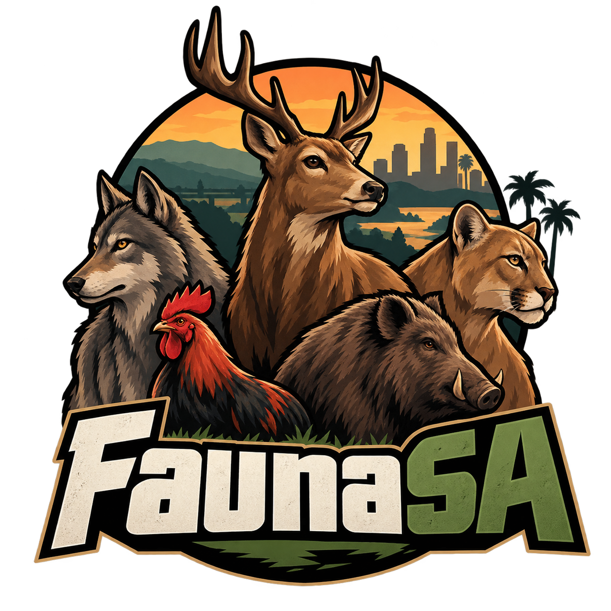
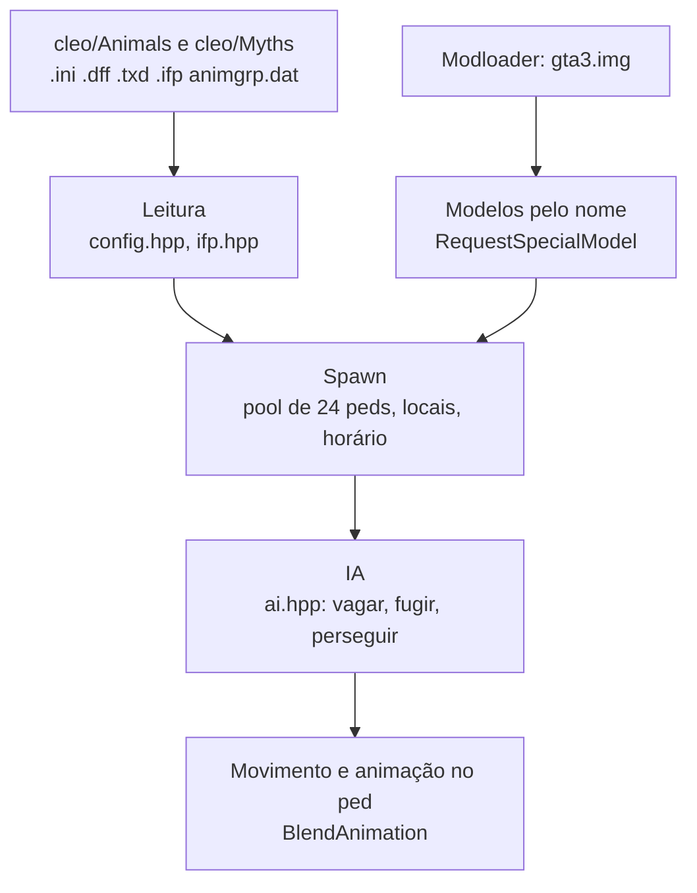

<div align="center">



# FaunaSA

*Motor leve em ASI para o pacote de animais do Myths Maker 2.7 (mais os packs de cães, gatos e animais extras), para quem quer animais no GTA San Andreas sem o peso e a instabilidade dos scripts CLEO.*

</div>

<p align="center">
  
  
  
</p>

| | |
| --- | --- |
| **Versão** | 1.0.0 |
| **Estado** | Estável (1.0): spawn, animação, IA básica, população por zona, buzina, cavalo e os animais extras funcionam na instalação do autor; falta a paridade com o mod original e há problemas conhecidos (seção 7) |
| **Contexto** | Projeto pessoal de modding, feito a partir da engenharia reversa do Myths Maker 2.7 |
| **Alvo** | `gta_sa.exe` 1.0 US, com ASI Loader, Modloader e Open Limit Adjuster |

> **Aviso:** o código deste repositório é MIT, mas os modelos, texturas e animações dos animais **não são meus**: são do Myths Maker 2.7 / Animals Pack (nadalao, Tarzan_3, Junior_Djjr e outros), do *Dog Pack* e do *Cat Pack* (Vadim Panenko, StrideR e outros) e do *Pack de animais* (kh gamer). O pacote completo da [release](https://github.com/josemurilors/faunaSA/releases), que inclui também os arquivos do cavalo (New Horse Mod, de nadalao e outros, sem termos de redistribuição na página de origem), os redistribui **com os créditos dos autores originais** ([CREDITS.md](CREDITS.md)); eles não estão no repositório (só o código). Os packs de cães, gatos e animais extras **não trazem licença explícita** nas páginas de origem: se você é autor e quer a remoção, abra uma issue. O FaunaSA **substitui** o script CLEO `Myths_Maker.cs`: os dois não podem rodar juntos.

## Sumário

1. [Objetivo](#1-objetivo)
2. [Arquitetura](#2-arquitetura)
3. [Estrutura do repositório](#3-estrutura-do-repositório)
4. [Regras e algoritmos](#4-regras-e-algoritmos)
5. [Resiliência e diagnóstico](#5-resiliência-e-diagnóstico)
6. [Execução local](#6-execução-local)
7. [Critérios de aceite](#7-critérios-de-aceite)
8. [Limites de escopo e evolução](#8-limites-de-escopo-e-evolução)
9. [Documentação complementar](#9-documentação-complementar)
10. [Créditos, autores e licença](#10-créditos-autores-e-licença)

## Início rápido

**Pacote pronto:** baixe `FaunaSA-v1.0.0.zip` na [release](https://github.com/josemurilors/faunaSA/releases), extraia na pasta do jogo (ao lado do `gta_sa.exe`, onde já ficam `modloader` e `cleo`) e pronto: o zip já traz o plugin, a configuração, os animais, as animações geradas e os modelos registrados no Modloader (`modloader\Myths Maker`). Não há mais nada para instalar. Remova o `Myths_Maker.cs`/`MythsMaker.asi` antigos.

**A partir do código** (para quem já tem o mod original):

Pré-requisito: `gta_sa.exe` 1.0 US com ASI Loader, Modloader e Open Limit Adjuster (com `PedModels = unlimited`), e as pastas `Animals` e `Myths` do Myths Maker 2.7.

```powershell
# 1. copie cleo\Animals e cleo\Myths (SEM os arquivos .cs) para <jogo>\cleo
# 2. registre os modelos no Modloader
.\tools\install_models.ps1 -Jogo "D:\Games\GTA San Andreas"
# 3. gere as animações e os modelos com 4 patas dos animais sem .ifp e instale (feche o jogo)
.\tools\install_anims.ps1 -Jogo "D:\Games\GTA San Andreas"
# 4. copie o plugin (gerado por build.bat, seção 6) e a configuração para a pasta do jogo
Copy-Item out\FaunaSA.asi "D:\Games\GTA San Andreas\"
Copy-Item docs\FaunaSA.ini  "D:\Games\GTA San Andreas\"
```

Carregue um save, espere uns 10 segundos com o controle ligado e aperte **F9**, escolha o animal na lista e **Enter** para spawnar à sua frente.

## 1. Objetivo

O Myths Maker roda como scripts CLEO: cada animal ativo é um script próprio, o carregamento de modelos trava o frame e o jogo fica pesado e instável com muitos animais. O FaunaSA lê **as mesmas pastas e `.ini`** do mod e roda como um único plugin C++ com tick único, pool fixo de peds e carga de modelo sem bloqueio.

**Faz:** spawn nos locais dos `.ini` (raio, horário, quantidade), modelos por nome, animações próprias dos `.ifp`, IA básica (vagar, fugir, perseguir, morder), sons `.mp3` dos animais (aleatório, dano, ataque, spawn), o **cavalo cavalgável** (adaptação do New Horse Mod de nadalao) e, desde a 0.3.0, os **animais extras** dos packs externos: cães (10 raças grandes, cão marrom), gatos (6 cores), lobo, urso preto, leão, tigre e flamingo (seção 4).

**Não faz (ainda):** interação com os animais, domesticar, radar e mapa de vida selvagem, locais por dia da semana e clima, o caçador `Anim0`, menu dentro do jogo (seção 8).

## 2. Arquitetura



Um único callback por frame (`gameProcessEvent`) roda tudo e só age com o jogo jogável (sem cutscene, controle ligado há 5 s).

### Stack tecnológica

| Área | Escolha | Papel |
| --- | --- | --- |
| Plugin | C++ (MSVC v143, 32 bits, `/MT`) com [plugin-sdk](https://github.com/DK22Pac/plugin-sdk) | Acesso às estruturas do jogo |
| Modelos | Modloader (`gta3.img`) | Registra os `.dff`/`.txd` como modelos especiais |
| Testes | `assert` em `tests/test_config.cpp` | Lógica pura: `.ini`, pool, horário, IA, IFP |
| Ferramentas | Python 3, PowerShell | Análise de esqueleto, instalação dos modelos |

## 3. Estrutura do repositório

```text
FaunaSA/
├── src/
│   ├── main.cpp         # ASI: spawn, modelos, animações, IA no jogo, log, vigia
│   ├── config.hpp       # leitura dos .ini do Myths Maker
│   ├── pool.hpp         # pool de slots, janela de horário, escolha de local
│   ├── ifp.hpp          # leitor de IFP ANP3 e de animgrp.dat
│   └── ai.hpp           # máquina de estados dos animais (sem dependência do jogo)
├── tests/               # test_config.cpp e fixtures
├── tools/               # compare_skeletons.py, gen_ifp.py, import_pack.py, decimate_dff.py, install_*.ps1, make_release.py
├── docs/                # PLANO.md, ESQUELETOS.md, FaunaSA.ini
└── build.bat            # compila os testes, roda e compila o .asi
```

## 4. Regras e algoritmos

- **Ativação** (do script original): o animal nasce quando você está a `spawn radius + 120` m (3D) de um local do `.ini`, dentro da janela `starting/ending hour`, abaixo de `myth quantity` e com o chão carregado. Nasce espalhado em volta do local, na altura real do chão. Máximo de animais vivos configurável (`MaxLive`).
- **Modelos:** `A<n>_<k>` / `M<n>_<k>` pelo nome, num ID livre de 15000 a 16000; no máximo 16 modelos sem uso ficam carregados. Pastas com `.dff`/`.txd` idênticos (raposa, leopardo, lobo, panda... repetidos em vários mitos) dividem **um só** modelo carregado (161 modelos do pacote original viram 52 distintos).
- **Locais vazios:** vagas `x=0 y=0 z=0` dos `.ini` (não preenchidas; (0, 0) é a fazenda Blueberry) são ignoradas, como no mod original.
- **Animação:** os `.ifp` (ANP3) são lidos pelo ASI e descomprimidos na carga, **fora** das tabelas do jogo (que têm no máximo 180 blocos e já costumam estar cheias). O deslocamento horizontal da raiz é zerado e a velocidade vem dele.
- **IA:** vagar (`walk mode`), presas (cervo, coelho) fogem a menos de 15 m, atacantes (`attacks peds/animals`) perseguem o ped mais próximo a até 25 m e mordem a 2 m (dano = metade de `damage`, intervalo por `attack rate`).
- **Animais sem `.ifp` próprio:** `FaunaSA.ini`, seção `[AnimGroups]`, mapeia a pasta para um grupo existente (padrão: ovelha → `Boar`). Os demais (vaca, avestruz, gorila, raposa, capivara, pato, galinha) usam IFPs gerados por `tools/gen_ifp.py` (passo 3 do início rápido); vaca, raposa e capivara também ganham um `.dff` com as quatro patas separadas. Sem os IFPs, o animal cai no andar/correr de humano do jogo; ver [docs/ESQUELETOS.md](docs/ESQUELETOS.md).
- **População por zona:** `FaunaSA.ini`, `[Population]`: `UrbanScale` (padrão 0,3) e `RuralScale` (padrão 1,5) multiplicam o `myth quantity` do `.ini` conforme a zona do local onde o animal nasce (cidade = Los Santos, San Fierro e Las Venturas; o resto é campo/floresta); `MaxLive` (padrão 32, até 48) limita os animais vivos no mundo todo.
- **Buzina:** com `[Horn] Enabled=1`, o motorista NPC de um carro em movimento buzina quando um cachorro ou gato (`Animals=all` vale para todos os animais) está na frente, até uns 8 m + 1,2 s de velocidade, e o animal corre para o lado depois de ~0,35 s. Não vale para o carro do jogador.
- **Menu de teste:** **F9** abre/fecha a lista de animais (setas ou PgUp/PgDn escolhem, **Enter** spawna à frente do jogador); **F8** grava no log os mitos mais próximos e a distância ao local.

### Animais extras (packs externos)
`tools/import_pack.py` cria uma pasta `AnimNN` por animal (`Anim90` a `Anim100`, sem a `Anim92`, a `Anim97` e a `Anim98`) com uma variante `A<NN>_<k>` por raça ou cor, sorteada a cada spawn; o `.ini` vem de um animal parecido (mesmos locais, horário e comportamento). `tools/decimate_dff.py` reduz as malhas pesadas dos cães e gatos (60 mil triângulos) para 10 mil, mantendo UV e pesos de skin; os atlas de textura (256×256) vêm do pack já otimizado. As animações são geradas por `tools/gen_ifp.py` como as dos outros animais sem `.ifp`.

| Pasta | Animal | Variantes |
| --- | --- | --- |
| `Anim90` | leão | 1 |
| `Anim91` | tigre | 1 |
| `Anim93` | flamingo | 1 |
| `Anim94` | cães grandes | 10 raças (Boxer, Dálmata, Doberman, Pastor, Bull, Malamute...) |
| `Anim95` | gatos | 6 cores (branco, laranja, malhado, malhado-laranja, preto, siamês) |
| `Anim96` | cão marrom | 3 |
| `Anim99` | lobo | 1 |
| `Anim100` | urso preto | 1 |

**Limitações:** só `gta_sa.exe` 1.0 US (endereços fixos); só os valores de `location mode = 2` (todos os locais) são tratados; `weather` é ignorado.

### Cavalo
Adaptação do [New Horse Mod](https://www.mixmods.com.br/2018/12/novo-mod-de-cavalo-by-nadalao/): nove cavalos nos mesmos locais do mod (nascem a 100 m, somem a 140 m depois de 60 s), vida 1500. Chegue a 3 m e aperte a tecla de **entrar no veículo** (a dica aparece na tela) para montar e de novo para desmontar. Dá para mirar e atirar do cavalo (com zoom ao mirar; limite de abertura da mira experimental e desligado por padrão: `[Horse] AimLimit=150` no `FaunaSA.ini`). Analógico/WASD: rumo e marcha (anda e depois corre); **tecla de correr**: galope; **tecla de pular**: pulo. Os arquivos do cavalo (modelo, animações e sons do New Horse Mod) vão no pacote da release, com crédito ([CREDITS.md](CREDITS.md)); quem monta a partir do código instala os seus com `tools/install_horse.ps1`. Sem os arquivos o cavalo fica desligado; `[Horse] Enabled=0` no `FaunaSA.ini` também desliga. No **F9**, a primeira entrada spawna um cavalo à sua frente.

## 5. Resiliência e diagnóstico

- **Log** `FaunaSA.log` na pasta do jogo: modelos pedidos e carregados, spawns, ataques, diagnóstico de movimento (`MOVE`, `ANIM`).
- **Crash:** um handler grava `CRASH` com o endereço, o módulo e os retornos de pilha dentro do `gta_sa.exe`.
- **Travamento:** um vigia grava `TRAVADO` com o endereço e a etapa do ASI se o jogo ficar 8 s sem chamá-lo.

Isso ajuda a localizar falhas; não prova que o plugin funciona em outras instalações de jogo ou combinações de mods.

## 6. Execução local

### Pré-requisitos

- Visual Studio 2022 (C++ para desktop, toolset v143) em `C:\Program Files\Microsoft Visual Studio\2022\Community`.
- plugin-sdk com `Plugin.lib` compilada (Release, Win32).
- Python 3 (só para as ferramentas em `tools/`).

### Passo a passo

```powershell
git clone --depth 1 https://github.com/DK22Pac/plugin-sdk.git E:\projetos\plugin-sdk
$env:PLUGIN_SDK_DIR = "E:\projetos\plugin-sdk"
& "$env:PLUGIN_SDK_DIR\tools\premake\premake5.exe" vs2022 --file="$env:PLUGIN_SDK_DIR\tools\premake\premake5.lua"
msbuild "$env:PLUGIN_SDK_DIR\plugin_sa\Plugin_SA.vcxproj" /p:Configuration=Release /p:Platform=Win32
```

Depois, na raiz do projeto:

```bat
build.bat
```

### Testes

O `build.bat` já compila e roda `tests\test_config.exe` antes de gerar `out\FaunaSA.asi`; rode da raiz (os testes leem `tests\fixtures`). Feche o jogo antes de copiar o `.asi`: o arquivo fica travado enquanto ele roda.

## 7. Critérios de aceite

- [x] Lê os `.ini` do mod (testes automáticos)
- [x] Modelos carregam e os animais aparecem no jogo
- [x] Animações próprias carregam sem registrar blocos no jogo
- [x] IA básica: vagar, fugir, perseguir e morder
- [ ] Movimento fluido, sem deslizar os pés: correção de velocidade instalada, falta confirmar
- [ ] Textura certa do animal amarelo-esverdeado: causa ainda não identificada
- [ ] Animação dos 6 tipos sem `.ifp` (vaca, gorila, raposa, capivara, pato, galinha): IFPs procedurais gerados (pernas em pares, sem pata a pata; falta ver no jogo)
- [x] Sons dos animais (`random`, `damage`, `anim_N`, `spawn`) pelo `bass.dll` do jogo (sem teste no jogo)
- [ ] Animais extras (`Anim90`–`Anim100`): importados, com animações geradas e modelos reduzidos; falta ver no jogo (o leão tem uma perna e a cauda sem animação)
- [ ] **Problema conhecido:** montado, as balas saem mais baixas que a mira (todas as armas); `[Horse] AlignGun=0` e o log `SHOTDIAG` do `FaunaSA.log` são o ponto de partida para corrigir
- [ ] Cavalo: nasce nos 9 locais do mod, monta/desmonta, anda, corre, galopa, pula, sons de casco (implementado; falta testar no jogo; sem garupa nem cavalo domável)
- [ ] Paridade: interação, domesticar, radar, caçador, locais por dia, clima
- [ ] Medição de desempenho contra o mod original
- [ ] Ferramenta para criar animais e tecla para recarregar os `.ini`

## 8. Limites de escopo e evolução

**Dentro:** rodar o pacote de animais existente de forma leve e estável.
**Fora:** distribuir assets, menu de edição dentro do jogo (por enquanto), suporte a outras versões do `gta_sa.exe`.
**Evoluções possíveis:** animações geradas por código para quem não tem `.ifp`; ver [docs/PLANO.md](docs/PLANO.md).

## 9. Documentação complementar

- [docs/PLANO.md](docs/PLANO.md): decisões e fases.
- [docs/ESQUELETOS.md](docs/ESQUELETOS.md): comparação de esqueleto e pose entre os animais e os grupos de animação.
- [docs/FaunaSA.ini](docs/FaunaSA.ini): configuração de exemplo.
- [CREDITS.md](CREDITS.md): autores de cada pacote usado.

## 10. Créditos, autores e licença

O FaunaSA só existe por causa do trabalho de outras pessoas. **Myths Maker** é de **nadalao**; os animais e as animações, de **Tarzan_3**; texturas, o plugin `SimpleLimitAdjuster_ExtraDir`, o CLEO+ e as vozes de IA, de **Junior_Djjr**. O cavalo, o cachorro animado (Infinity Ward, mcmillan, Dayk) e vários skins têm outros autores, listados nas páginas abaixo. O formato dos arquivos e as regras de spawn vêm da engenharia reversa do mod, para interoperar com ele.

- [Myths Maker 2.7 (libertycity.net)](https://libertycity.net/files/gta-san-andreas/182061-myths_maker-2.7-animal-world.html): termos do autor: uso em outros projetos com crédito, sem alterar splash, logo e descrição do mod original.
- [Myths Maker – Animals Pack (mixmods)](https://www.mixmods.com.br/2022/10/myths-maker-animals-pack-mod-de-animais/)
- [Myths Maker: criar mitos e lendas (mixmods)](https://www.mixmods.com.br/2022/10/myths-maker-criar-mitos-lendas/)
- [Pack de animais (mixmods)](https://www.mixmods.com.br/2014/03/pack-de-animais/): autor kh gamer; leão, tigre, flamingo, lobo e urso (o lagarto não entrou: a animação gerada não ficou boa).
- [Dog Pack (libertycity.net)](https://libertycity.net/files/gta-san-andreas/98286-dog-pack.html): Vadim Panenko; modelos de StrideR e Ganic; skins por KOT33.
- [Cat Pack (libertycity.net)](https://libertycity.net/files/gta-san-andreas/91485-cat-pack.html): Vadim Panenko.
- [Texture Optimizer (gtastuff.com)](https://gtastuff.com/tools/texture-optimizer/): atlas de textura 256×256 dos cães e gatos.

Também foram usados como referência técnica: [plugin-sdk](https://github.com/DK22Pac/plugin-sdk), [gta-reversed](https://github.com/gta-reversed/gta-reversed) e o código aberto do [CLEO+](https://github.com/JuniorDjjr/CLEOPlus).

| Nome | Papel | GitHub |
| --- | --- | --- |
| José Murilo R. Sabalo | Autor do FaunaSA (plugin, gerador de animações, ferramentas) | [josemurilors](https://github.com/josemurilors) |

**Licença:** [MIT](LICENSE). Cobre só o código deste repositório; modelos, texturas e animações do Myths Maker e dos packs de cães, gatos e animais seguem os termos dos autores originais ([CREDITS.md](CREDITS.md)). Se você é autor de algo no pacote e quer que seja removido, abra uma issue.
