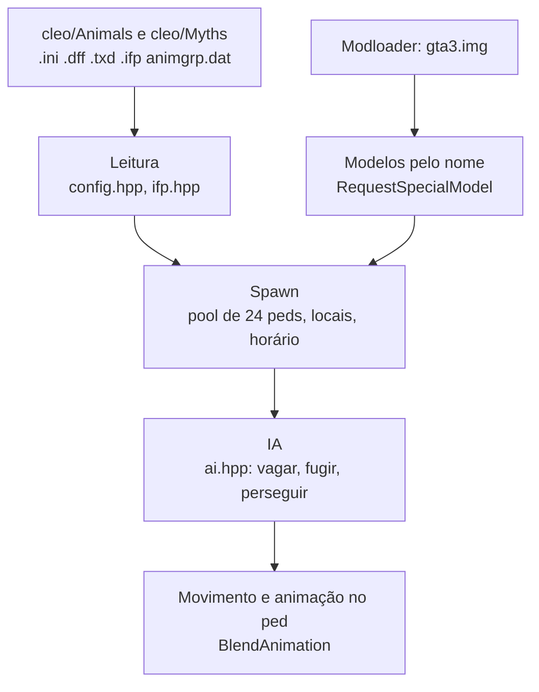

<div align="center">


# FaunaSA

*Motor leve em ASI para o pacote de animais do Myths Maker 2.7, para quem quer animais no GTA San Andreas sem o peso e a instabilidade dos scripts CLEO.*

</div>

<p align="center">
  
  
  
</p>

| | |
| --- | --- |
| **Versão** | 0.1 |
| **Estado** | Alfa: spawn, animação e IA básica funcionam na instalação do autor; falta a paridade com o mod original (seção 7) |
| **Contexto** | Projeto pessoal de modding, feito a partir da engenharia reversa do Myths Maker 2.7 |
| **Alvo** | `gta_sa.exe` 1.0 US, com ASI Loader, Modloader e Open Limit Adjuster |

> **Aviso:** o código deste repositório é MIT, mas os modelos, texturas e animações dos animais **não são meus**: são do Myths Maker 2.7 / Animals Pack (nadalao, Tarzan_3, Junior_Djjr e outros). O pacote completo da [release](https://github.com/josemurilors/faunaSA/releases) os redistribui **com os créditos dos autores originais** ([CREDITS.md](CREDITS.md)); eles não estão no repositório (só o código). O FaunaSA **substitui** o script CLEO `Myths_Maker.cs`: os dois não podem rodar juntos.

## Sumário

1. [Objetivo](#1-objetivo)
2. [Arquitetura](#2-arquitetura)
3. [Estrutura do repositório](#3-estrutura-do-repositório)
4. [Regras e algoritmos](#4-regras-e-algoritmos)
5. [Resiliência e diagnóstico](#5-resiliência-e-diagnóstico)
6. [Execução local](#6-execução-local)
7. [Critérios de aceite](#7-critérios-de-aceite)
8. [Limites de escopo e evolução](#8-limites-de-escopo-e-evolução)
9. [Documentação complementar](#9-documentação-complementar)
10. [Créditos, autores e licença](#10-créditos-autores-e-licença)

## Início rápido

**Pacote pronto:** baixe `FaunaSA-v0.1.0.zip` na [release](https://github.com/josemurilors/faunaSA/releases), extraia na pasta do jogo (ao lado do `gta_sa.exe`) e pronto: o zip já traz o plugin, a configuração, os animais, as animações geradas e os modelos registrados no Modloader. Remova o `Myths_Maker.cs`/`MythsMaker.asi` antigos.

**A partir do código** (para quem já tem o mod original):

Pré-requisito: `gta_sa.exe` 1.0 US com ASI Loader, Modloader e Open Limit Adjuster (com `PedModels = unlimited`), e as pastas `Animals` e `Myths` do Myths Maker 2.7.

```powershell
# 1. copie cleo\Animals e cleo\Myths (SEM os arquivos .cs) para <jogo>\cleo
# 2. registre os modelos no Modloader
.\tools\install_models.ps1 -Jogo "D:\Games\GTA San Andreas"
# 3. gere as animações e os modelos com 4 patas dos animais sem .ifp e instale (feche o jogo)
.\tools\install_anims.ps1 -Jogo "D:\Games\GTA San Andreas"
# 4. copie o plugin (gerado por build.bat, seção 6) e a configuração para a pasta do jogo
Copy-Item out\FaunaSA.asi "D:\Games\GTA San Andreas\"
Copy-Item docs\FaunaSA.ini  "D:\Games\GTA San Andreas\"
```

Carregue um save, espere uns 10 segundos com o controle ligado e aperte **F9**, escolha o animal na lista e **Enter** para spawnar à sua frente.

## 1. Objetivo

O Myths Maker roda como scripts CLEO: cada animal ativo é um script próprio, o carregamento de modelos trava o frame e o jogo fica pesado e instável com muitos animais. O FaunaSA lê **as mesmas pastas e `.ini`** do mod e roda como um único plugin C++ com tick único, pool fixo de peds e carga de modelo sem bloqueio.

**Faz:** spawn nos locais dos `.ini` (raio, horário, quantidade), modelos por nome, animações próprias dos `.ifp`, IA básica (vagar, fugir, perseguir, morder).

**Não faz (ainda):** cavalo e interação, domesticar, sons, radar e mapa de vida selvagem, locais por dia da semana e clima, o caçador `Anim0`, menu dentro do jogo (seção 8).

## 2. Arquitetura



Um único callback por frame (`gameProcessEvent`) roda tudo e só age com o jogo jogável (sem cutscene, controle ligado há 5 s).

### Stack tecnológica

| Área | Escolha | Papel |
| --- | --- | --- |
| Plugin | C++ (MSVC v143, 32 bits, `/MT`) com [plugin-sdk](https://github.com/DK22Pac/plugin-sdk) | Acesso às estruturas do jogo |
| Modelos | Modloader (`gta3.img`) | Registra os `.dff`/`.txd` como modelos especiais |
| Testes | `assert` em `tests/test_config.cpp` | Lógica pura: `.ini`, pool, horário, IA, IFP |
| Ferramentas | Python 3, PowerShell | Análise de esqueleto, instalação dos modelos |

## 3. Estrutura do repositório

```text
FaunaSA/
├── src/
│   ├── main.cpp         # ASI: spawn, modelos, animações, IA no jogo, log, vigia
│   ├── config.hpp       # leitura dos .ini do Myths Maker
│   ├── pool.hpp         # pool de slots, janela de horário, escolha de local
│   ├── ifp.hpp          # leitor de IFP ANP3 e de animgrp.dat
│   └── ai.hpp           # máquina de estados dos animais (sem dependência do jogo)
├── tests/               # test_config.cpp e fixtures
├── tools/               # compare_skeletons.py, gen_ifp.py, install_anims.ps1, install_models.ps1
├── docs/                # PLANO.md, ESQUELETOS.md, FaunaSA.ini
└── build.bat            # compila os testes, roda e compila o .asi
```

## 4. Regras e algoritmos

- **Ativação** (do script original): o animal nasce quando você está a `spawn radius + 120` m (3D) de um local do `.ini`, dentro da janela `starting/ending hour`, abaixo de `myth quantity` e com o chão carregado. Nasce espalhado em volta do local, na altura real do chão. Máximo de 24 animais vivos.
- **Modelos:** `A<n>_<k>` / `M<n>_<k>` pelo nome, num ID livre de 15000 a 16000; no máximo 16 modelos sem uso ficam carregados.
- **Animação:** os `.ifp` (ANP3) são lidos pelo ASI e descomprimidos na carga, **fora** das tabelas do jogo (que têm no máximo 180 blocos e já costumam estar cheias). O deslocamento horizontal da raiz é zerado e a velocidade vem dele.
- **IA:** vagar (`walk mode`), presas (cervo, coelho) fogem a menos de 15 m, atacantes (`attacks peds/animals`) perseguem o ped mais próximo a até 25 m e mordem a 2 m (dano = metade de `damage`, intervalo por `attack rate`).
- **Animais sem `.ifp` próprio:** `FaunaSA.ini`, seção `[AnimGroups]`, mapeia a pasta para um grupo existente (padrão: ovelha → `Boar`). Os demais (vaca, avestruz, gorila, raposa, capivara, pato, galinha) usam IFPs gerados por `tools/gen_ifp.py` (passo 3 do início rápido); vaca, raposa e capivara também ganham um `.dff` com as quatro patas separadas. Sem os IFPs, o animal cai no andar/correr de humano do jogo; ver [docs/ESQUELETOS.md](docs/ESQUELETOS.md).
- **Menu de teste:** **F9** abre/fecha a lista de animais (setas ou PgUp/PgDn escolhem, **Enter** spawna à frente do jogador); **F8** grava no log os mitos mais próximos e a distância ao local.

**Limitações:** só `gta_sa.exe` 1.0 US (endereços fixos); só os valores de `location mode = 2` (todos os locais) são tratados; `weather` é ignorado.

## 5. Resiliência e diagnóstico

- **Log** `FaunaSA.log` na pasta do jogo: modelos pedidos e carregados, spawns, ataques, diagnóstico de movimento (`MOVE`, `ANIM`).
- **Crash:** um handler grava `CRASH` com o endereço, o módulo e os retornos de pilha dentro do `gta_sa.exe`.
- **Travamento:** um vigia grava `TRAVADO` com o endereço e a etapa do ASI se o jogo ficar 8 s sem chamá-lo.

Isso ajuda a localizar falhas; não prova que o plugin funciona em outras instalações de jogo ou combinações de mods.

## 6. Execução local

### Pré-requisitos

- Visual Studio 2022 (C++ para desktop, toolset v143) em `C:\Program Files\Microsoft Visual Studio\2022\Community`.
- plugin-sdk com `Plugin.lib` compilada (Release, Win32).
- Python 3 (só para `tools/compare_skeletons.py`).

### Passo a passo

```powershell
git clone --depth 1 https://github.com/DK22Pac/plugin-sdk.git E:\projetos\plugin-sdk
$env:PLUGIN_SDK_DIR = "E:\projetos\plugin-sdk"
& "$env:PLUGIN_SDK_DIR\tools\premake\premake5.exe" vs2022 --file="$env:PLUGIN_SDK_DIR\tools\premake\premake5.lua"
msbuild "$env:PLUGIN_SDK_DIR\plugin_sa\Plugin_SA.vcxproj" /p:Configuration=Release /p:Platform=Win32
```

Depois, na raiz do projeto:

```bat
build.bat
```

### Testes

O `build.bat` já compila e roda `tests\test_config.exe` antes de gerar `out\FaunaSA.asi`; rode da raiz (os testes leem `tests\fixtures`). Feche o jogo antes de copiar o `.asi`: o arquivo fica travado enquanto ele roda.

## 7. Critérios de aceite

- [x] Lê os `.ini` do mod (testes automáticos)
- [x] Modelos carregam e os animais aparecem no jogo
- [x] Animações próprias carregam sem registrar blocos no jogo
- [x] IA básica: vagar, fugir, perseguir e morder
- [ ] Movimento fluido, sem deslizar os pés: correção de velocidade instalada, falta confirmar
- [ ] Textura certa do animal amarelo-esverdeado: causa ainda não identificada
- [ ] Animação dos 6 tipos sem `.ifp` (vaca, gorila, raposa, capivara, pato, galinha): IFPs procedurais gerados (pernas em pares, sem pata a pata; falta ver no jogo)
- [ ] Paridade: cavalo, interação, domesticar, sons, radar, caçador, locais por dia, clima
- [ ] Medição de desempenho contra o mod original
- [ ] Ferramenta para criar animais e tecla para recarregar os `.ini`

## 8. Limites de escopo e evolução

**Dentro:** rodar o pacote de animais existente de forma leve e estável.
**Fora:** distribuir assets, menu de edição dentro do jogo (por enquanto), suporte a outras versões do `gta_sa.exe`.
**Evoluções possíveis:** animações geradas por código para quem não tem `.ifp`; ver [docs/PLANO.md](docs/PLANO.md).

## 9. Documentação complementar

- [docs/PLANO.md](docs/PLANO.md): decisões e fases.
- [docs/ESQUELETOS.md](docs/ESQUELETOS.md): comparação de esqueleto e pose entre os animais e os grupos de animação.
- [docs/FaunaSA.ini](docs/FaunaSA.ini): configuração de exemplo.

## 10. Créditos, autores e licença

O FaunaSA só existe por causa do trabalho de outras pessoas. **Myths Maker** é de **nadalao**; os animais e as animações, de **Tarzan_3**; texturas, o plugin `SimpleLimitAdjuster_ExtraDir`, o CLEO+ e as vozes de IA, de **Junior_Djjr**. O cavalo, o cachorro animado (Infinity Ward, mcmillan, Dayk) e vários skins têm outros autores, listados nas páginas abaixo. O formato dos arquivos e as regras de spawn vêm da engenharia reversa do mod, para interoperar com ele.

- [Myths Maker 2.7 (libertycity.net)](https://libertycity.net/files/gta-san-andreas/182061-myths_maker-2.7-animal-world.html): termos do autor: uso em outros projetos com crédito, sem alterar splash, logo e descrição do mod original.
- [Myths Maker – Animals Pack (mixmods)](https://www.mixmods.com.br/2022/10/myths-maker-animals-pack-mod-de-animais/)
- [Myths Maker: criar mitos e lendas (mixmods)](https://www.mixmods.com.br/2022/10/myths-maker-criar-mitos-lendas/)

Também foram usados como referência técnica: [plugin-sdk](https://github.com/DK22Pac/plugin-sdk), [gta-reversed](https://github.com/gta-reversed/gta-reversed) e o código aberto do [CLEO+](https://github.com/JuniorDjjr/CLEOPlus).

| Nome | Papel | GitHub |
| --- | --- | --- |
| José Murilo R. Sabalo | Autor do FaunaSA (plugin, gerador de animações, ferramentas) | [josemurilors](https://github.com/josemurilors) |

**Licença:** [MIT](LICENSE). Cobre só o código deste repositório; modelos, texturas e animações do Myths Maker seguem os termos dos autores originais ([CREDITS.md](CREDITS.md)). Se você é autor de algo no pacote e quer que seja removido, abra uma issue.
